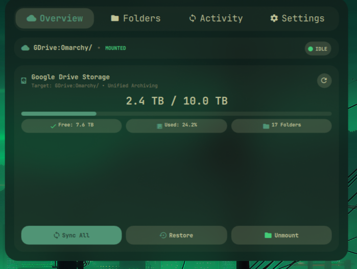
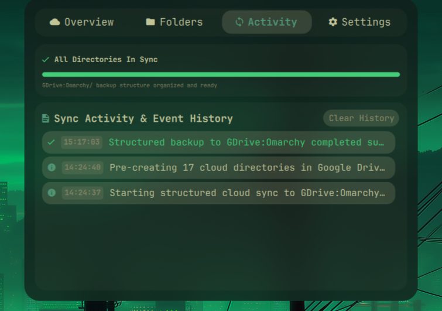
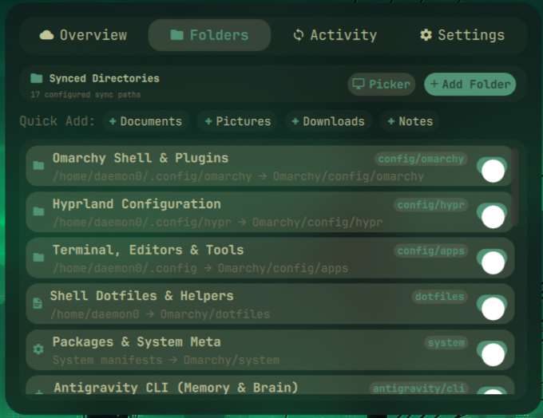
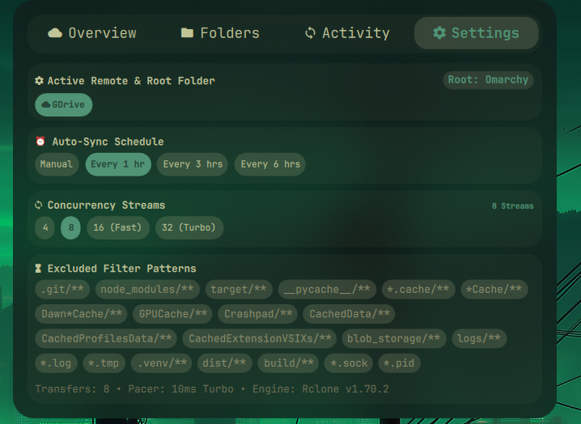

# Cloud Sync (`omarchy-cloud-sync`)

> **Unofficial / Community Project**: This is an independent open-source plugin for Omarchy. Not affiliated with Omarchy, Arch Linux, or the Rclone project.

A cloud backup and synchronization telemetry dashboard for Omarchy Quickshell with optional [Rclone](https://rclone.org/) integration and systemd user services.

---

## Status / Experimental Warning

Synchronizing local desktop configurations and personal files to cloud remotes requires careful auditing. **This plugin does NOT include pre-configured cloud remotes, credentials, or API keys.** You must configure your own trusted Rclone remote before enabling synchronization. All sync targets are **opt-in** and disabled by default.

---

## Features

- **Telemetry & Status HUD**: Live transfer progress, network bandwidth, and remote storage quotas directly in the Omarchy top bar.
- **Folder Management**: Selectively sync configuration folders or personal directories to your configured cloud storage.
- **Rclone Integration**: Interfaces with standard `rclone` remotes (Google Drive, Dropbox, OneDrive, S3, WebDAV, SFTP, etc.).
- **Optional Systemd Timer**: Provides non-blocking background synchronization on an hourly schedule (must be explicitly enabled by user).
- **Safe Exclusions**: Prevents uploading credentials, tokens, or cache databases.

---

## Requirements

- **Operating System**: Arch Linux (rolling release, x86_64)
- **Desktop Shell**: Omarchy (`dev (13f18b2c) / 4.0.2`) with Quickshell (`0.3.1`)
- **Core Dependencies**: `python3`, `jq`, `bash`
- **Optional (Required for Cloud Backups)**: `rclone` (>= 1.60.0) configured via `rclone config`

---

## Compatibility

| Component | Tested Version | Compatibility Status |
|---|---|---|
| Omarchy | `dev (13f18b2c) / 4.0.2` | Fully compatible |
| Quickshell | `0.3.1` | Fully compatible |
| Rclone | 1.75.0 | Verified |

---

## Installation

### Method 1: Using Omarchy Plugin Manager

```bash
omarchy plugin add https://github.com/YOUR-USERNAME/omarchy-cloud-sync.git --enable
```

### Method 2: Using the Safe User Installer

```bash
git clone https://github.com/YOUR-USERNAME/omarchy-cloud-sync.git
cd omarchy-cloud-sync

./install.sh check
./install.sh install --dry-run
./install.sh install
```

---

## System Setup Before Installation

1. **Configure Rclone First**:
   Set up your preferred cloud remote using standard rclone commands:
   ```bash
   rclone config
   ```
   Verify you can connect to your remote:
   ```bash
   rclone lsd YOUR_REMOTE:
   ```
2. **Initialize Your Sync Specification**:
   Copy the example configuration to your Omarchy config directory:
   ```bash
   mkdir -p ~/.config/omarchy
   cp examples/cloud-sync.example.json ~/.config/omarchy/cloud-sync.json
   ```
   Edit `~/.config/omarchy/cloud-sync.json` to specify your remote name and enable the folders you wish to back up.
3. **Optional Automated Background Sync**:
   If you wish to enable periodic background backups:
   ```bash
   cp systemd/omarchy-cloud-sync.* ~/.config/systemd/user/
   systemctl --user daemon-reload
   systemctl --user enable --now omarchy-cloud-sync.timer
   ```
   *(Note: Never enabled automatically by the installer).*

---

## Usage

- **Bar Widget**: Shows sync status icon in top bar. Click to open the Sync Dashboard.
- **CLI Commands**:
  ```bash
  omarchy-cloud-sync status      # Display current remote storage and sync health
  omarchy-cloud-sync sync        # Run manual foreground synchronization
  ```

---

## Configuration

Settings are stored in `~/.config/omarchy/cloud-sync.json`. Example structure:

```json
{
  "remote": "MyCloudRemote",
  "remote_root": "Backups/LinuxDesktop",
  "folders": [
    {
      "id": "hypr_config",
      "name": "Hyprland Configuration",
      "path": "$HOME/.config/hypr",
      "remote_subpath": "config/hypr",
      "enabled": true
    }
  ]
}
```

---

## Update

```bash
omarchy plugin update daemon0.cloud-sync
```

---

## Uninstall / Rollback

```bash
./install.sh uninstall
```

If you enabled the systemd timer, disable it manually:
```bash
systemctl --user disable --now omarchy-cloud-sync.timer 2>/dev/null || true
```

---

## Security and Privacy

- **No Remote Bundling**: This public repo contains zero remote tokens, API secrets, or passwords.
- **Opt-In Only**: No directories are synced without explicit user configuration.
- **Sensitive Folder Warning**: Never synchronize credentials (`~/.ssh`, `~/.gnupg`, `~/.config/rclone/rclone.conf`) or browser profiles to unencrypted public cloud storage.

---

## Troubleshooting

- **"Rclone remote not found"**: Run `rclone listremotes` to check your remote name, and ensure it matches `"remote"` in `~/.config/omarchy/cloud-sync.json`.
- **Bandwidth throttling**: Adjust `"bandwidth_limit"` in configuration if backups saturate your connection.

---

## Showcase

> Visual previews, UI screenshots, and recordings for documentation and release verification.

### Main experience

<!-- Future image: assets/showcase/sync_overview.png -->
<!--  -->

### Feature gallery

<!-- Future image: assets/showcase/sync_overview.png -->
<!--  -->

<!-- Future image: assets/showcase/sync_activity.png -->
<!--  -->

<!-- Future image: assets/showcase/sync_folders.png -->
<!--  -->

<!-- Future image: assets/showcase/sync_settings.png -->
<!--  -->

<!-- Future image: assets/showcase/feature-05.png -->
<!--  -->

<!-- Future image: assets/showcase/feature-06.png -->
<!--  -->

<!-- Future image: assets/showcase/feature-07.png -->
<!--  -->

<!-- Future image: assets/showcase/feature-08.png -->
<!--  -->

<!-- Future image: assets/showcase/feature-09.png -->
<!--  -->

<!-- Future image: assets/showcase/feature-10.png -->
<!--  -->

### Motion and interaction

<!-- Future GIF: assets/showcase/interaction-01.gif -->
<!--  -->

<!-- Future GIF: assets/showcase/interaction-02.gif -->
<!--  -->

### Video demonstrations

<!-- Future thumbnail: assets/showcase/video-01-thumbnail.png -->
<!-- [](https://github.com/YOUR-USERNAME/PROJECT-NAME/releases) -->


---

## Contributing

Pull requests and feedback are appreciated!

---

## License

[MIT License](LICENSE).
